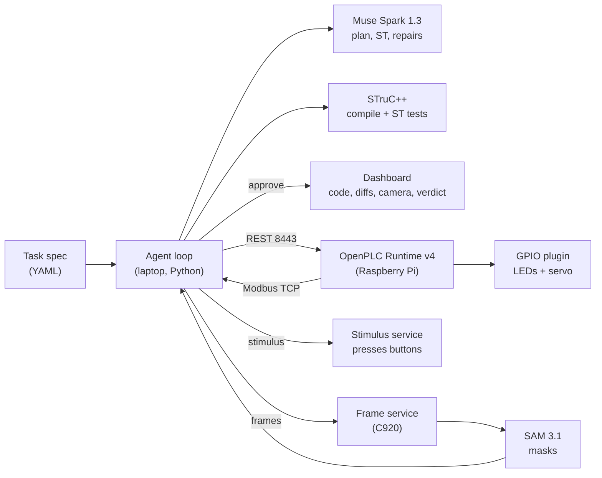
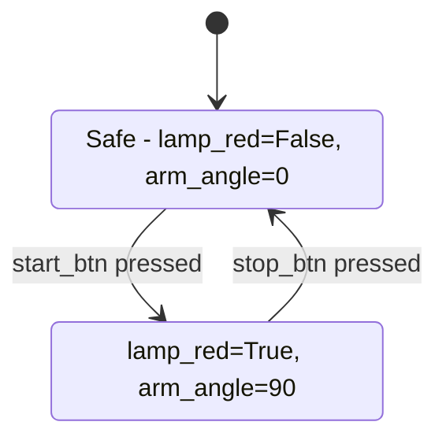

# vision-plc-agent

An agent that writes PLC logic, runs the tests and uses vision to verify the
physical result — telling code bugs apart from wiring faults.

Meta Global AI Developer Hackathon entry ("Push the Frontier"). You describe
the behaviour in plain English; the agent plans it, writes IEC 61131-3
Structured Text, deploys it to an OpenPLC Runtime on a Raspberry Pi, presses
real buttons, and checks the lamps and servo arm with a camera. When a test
fails it tells you whether the program is wrong or the wiring is.

> 🎬 Demo video (< 3 min): **[link TBD — upload and paste URL]**
> 
> *GIF TBD — record the dashboard during the rehearsal in `dashboard/DEMO.md`.*

## How it works

1. **Describe.** Write a task file in `specs/`: plain-English description plus
   the acceptance tests that prove it works. The engineer never writes ST.
2. **Plan + generate.** Muse Spark draws a state diagram, writes one
   `PROGRAM Main` plus ST unit tests; STruC++ compile/test errors feed back
   automatically (max 3 rounds).
3. **Approve.** The dashboard shows the diagram, the code and the diffs.
   Nothing deploys until a human clicks approve.
4. **Deploy + test.** The agent packages `program.zip`, uploads it over the
   OpenPLC REST API, plays the stimulus timeline through real GPIO, polls
   tags over Modbus TCP and grabs camera frames at every checkpoint.
5. **See + diagnose.** SAM 3.1 segments the LEDs and the arm; brightness and
   angle are measured against calibration. Spec vs tags vs camera decides:

| Spec vs tags | Tags vs camera | Verdict | Action |
| --- | --- | --- | --- |
| match | match | pass | record evidence |
| mismatch | camera agrees with tags | logic bug | fix ST, retry (max 3) |
| match | mismatch | physical fault | stop, report address + observed state |
| mismatch | mismatch | unclear | stop, ask the human |

Every run lands in `runs/<timestamp>-<task_id>/`: spec, prompts, ST, frames,
`report.json` (with token usage) and a readable `summary.txt`.

## Architecture



## The diagram the agent drew (demo task)

This is the actual plan Muse Spark produced for `specs/start_lamp_arm.yaml`
— also shown in the dashboard before you approve:



## Try it without hardware

```bash
uv sync
uv run pytest                         # fakes only: no Pi, no API, no credits
uv run python -m dashboard.server --port 8000   # open http://127.0.0.1:8000/
```

Then click **New task** in the dashboard: describe the behaviour, tick the
signals, paste the tests as YAML, Generate & run — fake mode runs the whole
loop in the page. Or from the CLI:

```bash
uv run python -m agent.loop specs/start_lamp_arm.yaml --fake
uv run ruff check . && uv run ruff format .
```

## Try it on the real rig

Bench rig: Raspberry Pi + OpenPLC Runtime v4, 3 LEDs, 2 buttons, optional
SG90 servo on a PCA9685, Logitech C920. The contract is `io_map.yaml`
(start `%IX0.0`, stop `%IX0.1`, red/green/yellow `%QX0.0–0.2`,
arm `%QW0` 0–180°).

```bash
cp .env.example .env   # fill in META_API_KEY, OPENPLC_*, PI_HOST, STIMULUS_URL, FRAMES_URL
uv run python -m agent.loop specs/start_lamp_arm.yaml --wait-approval 600
```

Review the pending run in the dashboard and click **Approve & deploy**.
Safety: the GPIO plugin clamps the arm to 0–180° and drops outputs when the
PLC stops; every program drives all outputs safe on `stop_btn` within one
scan; stimulus/frame services bind the Pi's Tailscale address.

Rehearsal checklist (including fault injection: pull an LED leg and watch the
agent blame the wiring, not the code): [`dashboard/DEMO.md`](dashboard/DEMO.md).
Video shot list: [`docs/VIDEO_SCRIPT.md`](docs/VIDEO_SCRIPT.md).

## Layout

```text
agent/            loop, codegen, deploy, vision, diagnosis (+ fakes for all)
dashboard/        one-page evidence UI: spec, ST + diffs, camera, timeline, verdict
pi/               gpio_plugin, stimulus_service, frame_service (run on the Pi)
specs/            task YAML files (+ generated diagrams)
tests/            pytest, fakes only
docs/SPEC.md      full project spec (source of truth)
```

AI core is Meta models via the Meta Model API (`muse-spark-1.3`, SAM 3.1),
each behind an interface with a fake. Our code is MIT; every dependency and
its licence is listed in [`THIRD_PARTY.md`](THIRD_PARTY.md).
