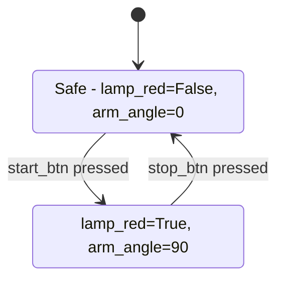

# Demo video script — under 3 minutes (target 2:30)

Record with OBS: screen (dashboard) + rig camera picture-in-picture. Audio:
voiceover recorded separately, or live narration. Rehearse once with
`dashboard/DEMO.md`. Assets: the state diagram below (screenshot the README
render or the dashboard diagram tab), one known-green run for safety.

| Time | Shot | Narration (approx) |
| --- | --- | --- |
| 0:00–0:20 | Rig close-up: Pi, 3 LEDs, buttons, servo, C920. Title card: "An agent that commissions a PLC like an engineer." | "This is a PLC bench rig. The task: when start is pressed, latch the red lamp and move the arm to 90 degrees. I describe it in plain English — the agent does everything else." |
| 0:20–0:50 | Dashboard, **New task** form. Type the description, tick signals, tests prefilled. Click Generate & run. Progress card sweeps; code appears in the code tab. | "I describe the behaviour and the tests that prove it. Muse Spark plans it — there's the state diagram — writes the Structured Text, and checks it with ST unit tests before anything touches hardware." |
| 0:50–1:10 | Pending banner (sticky, yellow). Scroll the ST, show a diff. Click **Approve & deploy**. Timeline fills green; click a frame, mask box overlaid. | "Nothing deploys without my approval. Then it uploads to the OpenPLC runtime, presses real buttons, and verifies with two independent sources: PLC tags and the camera." |
| 1:10–1:40 | Hand pulls the red LED leg. Re-run, approve. Verdict flips to `physical_fault`; summary line on screen. | "Now I pull the LED leg and re-run. Same program — but the camera disagrees with the tags. The agent stops and blames the wiring, not the code: logic correct, output true, lamp not lit." |
| 1:40–2:10 | Edit the spec copy (lamp off at 5.5 s instead of 3.5 s). Run; first verdict `logic_bug`; progress shows repairing; re-deploy; green. Show ST diff codegen → final. | "Change the spec instead, and it detects a real logic bug, repairs the program, re-deploys and re-verifies — here is the exact diff it made." |
| 2:10–2:30 | `report.json` + `summary.txt` in the run folder; verdict, token usage. Closing card: open-source stack (OpenPLC, STruC++, Muse Spark, SAM 3.1). | "Every run leaves evidence: spec, code, frames, verdict. An agent that writes PLC logic — and checks its work with its own eyes." |

## Recording notes

- Dashboard: `uv run python -m dashboard.server --port 8000`, loops with
  `--wait-approval 600` (fake for the codegen close-ups, real for the rig).
- Keep a known-green run dir copied aside; if the rig misbehaves on camera,
  the dashboard still presents recorded runs fully offline.
- Fault injection: pull the red LED leg (or cover it). Re-seat before the
  spec-change take.
- Cut if long: the 1:40 repair take compresses to one sentence + the diff.
  Never cut: the physical-fault take — it is the whole pitch.
